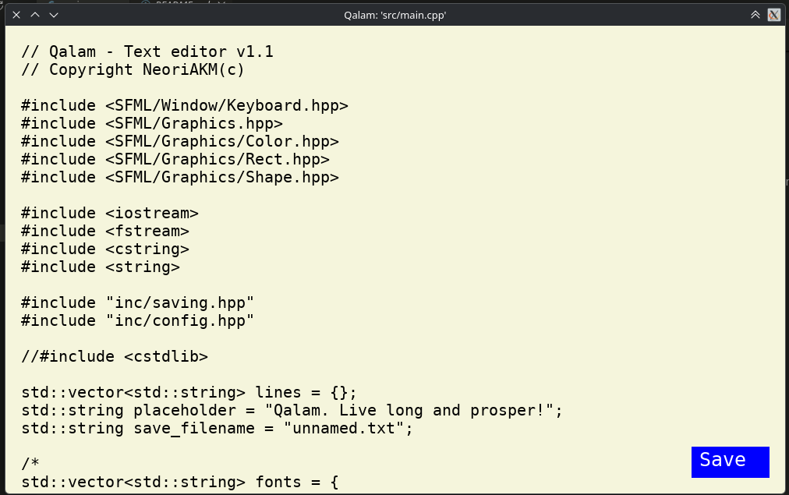
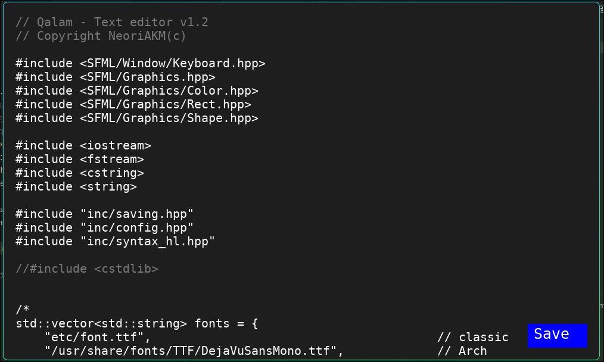
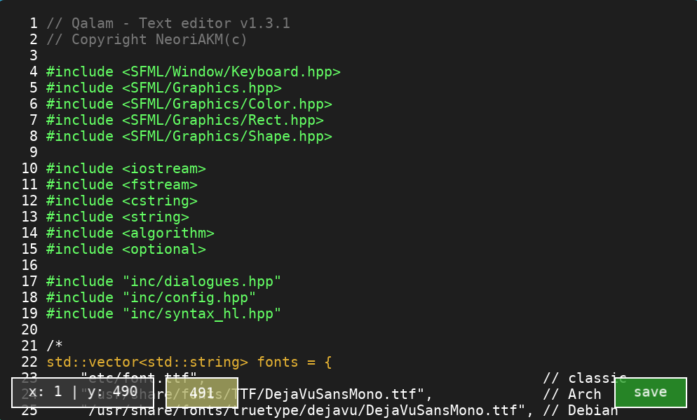

# Qalam - Text editor (v1.3.4)

My first C++ project. A lightweight text editor written in C++ using SFML.

As of today, it contains **1.1K** lines of code.

The name comes from the Arabic word **قلم** (qalam), meaning "*pen*".

## Features
- Basic work with lines and saving, like any other text editor
- Custom font, font size, and theme via config file
- Dark and light themes
- syntax highlight (only for NASM, and some for C++/C)
- (soon) Mods on Wren language

## Dependencies
- C++17 compiler (GCC/Clang)
- CMake (3.16+)
- [SFML 3](https://www.sfml-dev.org/) (Graphics, Window, System)
- [nlohmann/json](https://github.com/nlohmann/json)
- [wren](https://wren.io)

*And: recommended OS is linux. Often - Arch*

*Install all on Arch Linux:*

```bash
sudo pacman -S cmake sfml nlohmann-json
yay -S wren
```

## Build

```bash
cmake -B build # once
cmake --build build
```

## Run

```bash
./build/qalam [filename]
```

## Hotkeys

|    Hotkey    |                    Doing                   |
|:-------------|:------------------------------------------:|
| Ctrl+Scroll  | scrolling 2x faster                        |
| Ctrl+S       | saving file                                |
| Ctrl+Shift+S | choosing a dir to save file                |
| Ctrl+U       | moving cursor to center of screen          |
| Ctrl+C       | Copying string under cursor                |
| Ctrl+Shift+C | Copying all file to clipboard              |
| Ctrl+V       | pasting text from clipboard                |
| Ctrl+D       | copying string under cursor to next string |

## Flags

You can use some flags.

-
- `--nomods` or `

| flag | 1-letter flag | doing |
|:----:|:-------------:|:-----:|
| `--help` | `-h` | for reference |
| `--debug` | `-d` | for debug msgs in shell |
| `--version` | `-v` | shows version and license |
| `--nomods` | `-m` | turn off mods launch |

## Configuration

config file is located at `~/.config/qalam/config.json`. Sorry, windows users, I don't know how to make configs for windows.

Standard config:

```json
{
    "font": "/usr/share/fonts/TTF/DejaVuSansMono.ttf",
    "font_size": 20,
    "fps": 60,

    "w_width": 1000,
    "w_height": 600,

    "placeholder": "Qalam. Live long and prosper!",
    "unnamed": "unnamed.txt",

    "fg_c": [50,  50,  50],
    "bg_c": [255, 255, 255]
}
```

- `font_size` - size for your font. type - unsigned int
- `font` - absolute path to your font. `/usr/share/fonts/TTF/DejaVuSansMono.ttf` - path only for Arch linux
- `fps` - unsigned int typed value. Contains max FPS for Qalam window

- `w_width` and `w_height` - resolution of window. Dynamic window resizing is not realized yet

- `unnamed` - string-value. If you opening Qalam without specifying a file, you will open this file

- `fg_c` & `bg_c` - colors for background and foreground. Values are stored with decimal RGB

## Mods

Mods are VERY simple. Mod need to be in `~/.config/mod1.wren` Have only 1 command - `System.print`. I don't realized it to end yet. Who can help me pliz

## Last update

### 1.3.4

**Themes micro patch**

- New values in JSON config

- themes officially removed, and replaced by manual redacting decimal RGB color in config

### 1.3.3

**Mods origin**

- More definitions been moved to helper file

- Added MODS!

### 1.3.2

**Life quality**

- 2 new hotkeys. Ctrl+C copying string under cursor, Ctrl+Shift+C - copying all file.

- Added so many warning flags to CMakeLists.txt

- Fixed visual bug: It is draws lines over the background of numbers.

- Messages moved to new file - `helper.cpp`

### 1.3 & 1.3.1

**BIG life quality**

- Added string indexes lefter from text

- Added 2x modifier to scroll with pressed control

- Added label thats showing strings count

- Fixed bug, thats going segfault if you press backspace on empty last line. Now thats okay

### 1.2.1 & 1.2.2

**Parameters n Buttons**

- For contributors: You can make button with 1 variable. I made class Button

- added "unnamed" & "placeholder" parameters to config.

- fixed few bugs in `dialogues.cpp`

### 1.2

Syntax highlight

## Milestones

### normal
- [ ] split draw cycle to tokens

### lines count
> **You can check lines count with command** `find src -type f -name "*.cpp" -exec cat {} + | wc -l`

- [x] get 1000 lines
- [ ] get 1500 lines
- [ ] get 2000 lines
- [ ] get 5000 lines

## Gallery







---
---

Copyright NeoriAKM(c) | made with **love** and **C++**