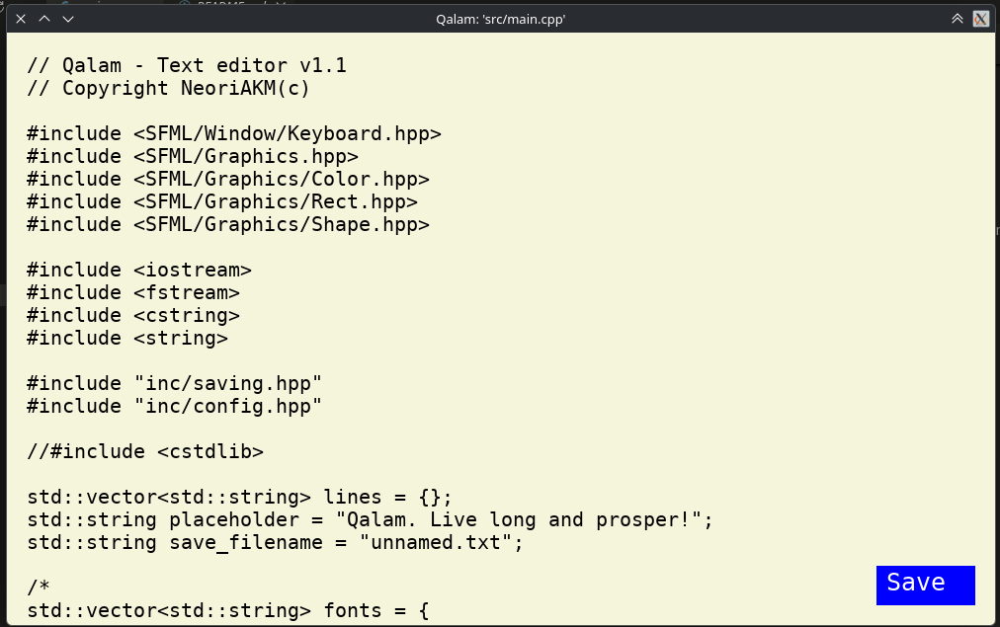
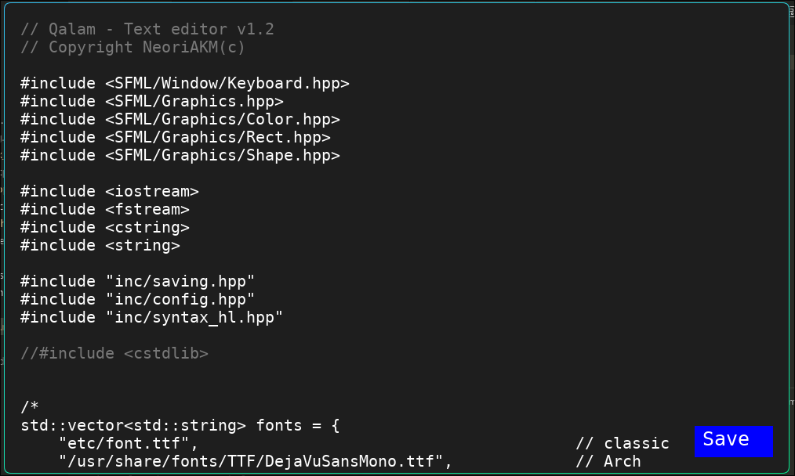
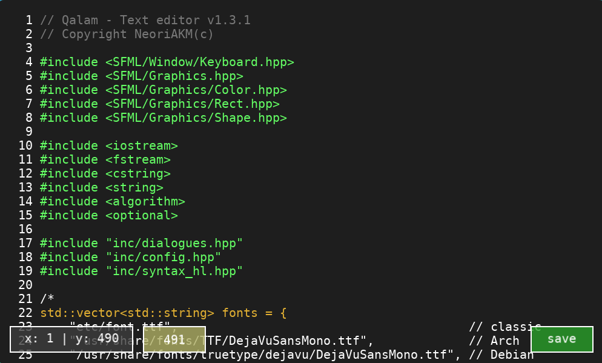

# Qalam - Text editor (v1.3.2)

My first C++ project. A lightweight text editor written in C++ using SFML.

The name comes from the Arabic word قلم (qalam), meaning "pen".

## Features
- Basic work with lines, like any other text editor
- Saving files
- Custom font, font size, and theme via config file
- Dark and light themes
- primitive syntax highlight (only for NASM. But comments in any lang)

## Dependencies
- C++17 compiler (GCC/Clang)
- CMake (3.16+)
- [SFML 3](https://www.sfml-dev.org/) (Graphics, Window, System)
- [nlohmann/json](https://github.com/nlohmann/json)

*On Arch Linux:* `sudo pacman -S cmake sfml nlohmann-json`

## Build

```bash
cmake -B build # once
cmake --build build
```

## Run

```bash
./build/qalam [filename]
```

## Hotkeys

- Ctrl+S and Ctrl+Shift+S : classical saving file
- Ctrl+U : moving cursor to center of screen
- Ctrl+Scroll : scrolling 2x faster
- Ctrl+C and Ctrl+Shift+C : Copying string under cursor **or** all file to clipboard
- Ctrl+V : pasting text from clipboard

## Flags

You can use some flags.
- `--help` or `-h`: for reference
- `--debug` or `-d`: for debug msgs in shell

## Configuration

config file is located at `~/.config/qalam/config.json`. Sorry, windows users, I don't know how to make configs for windows.

Standart config:

```json
{
    "font": "/usr/share/fonts/TTF/DejaVuSansMono.ttf",
    "font_size": 20,
    "theme": "dark",
    "fps": 60,

    "w_width": 1000,
    "w_height": 600,

    "placeholder": "Qalam. Live long and prosper!",
    "unnamed": "unnamed.txt"
}
```

- `font_size` - size for your font. type - unsigned int
- `font` - absolute path to your font. `/usr/share/fonts/TTF/DejaVuSansMono.ttf` - path only for Arch linux
- `theme` - `"dark"` or `"light"`. string type
- `fps` - unsigned int typed value. Contains max FPS for Qalam window

- `w_width` and `w_height` - resolution of window. I don't know how to do it dynamic

- `unnamed` - string-value. If you opening Qalam without specifying a file, you will open this file

## Last update

### 1.3.2

- 2 new hotkeys. Ctrl+C copying string under cursor, Ctrl+Shift+C - copying all file.

- Added so many warning flags to CMakeLists.txt

- Fixed visual bug: It is draws lines over the background of numbers.

- Messages moved to new file - `helper.cpp`

### 1.3 & 1.3.1

- Added string indexes lefter from text

- Added 2x modifier to scroll with pressed control

- Added label thats showing strings count

- Fixed bug, thats going segfault if you press backspace on empty last line. Now thats okay

### 1.2.1 & 1.2.2

- For contributors: You can make button with 1 variable. I made class Button

- added "unnamed" & "placeholder" parameters to config.

- fixed few bugs in `dialogues.cpp`

### 1.2

Syntax highlight

## Milestones

- [x] get 1000 lines with `find src -type f -name "*.cpp" -exec cat {} + | wc -l`
- [ ] get 2000 lines
- [ ] get 5000 lines
- [ ] split draw cycle to tokens

## Gallery







---
---

Copyright NeoriAKM(c) | made with **love** and **C++**