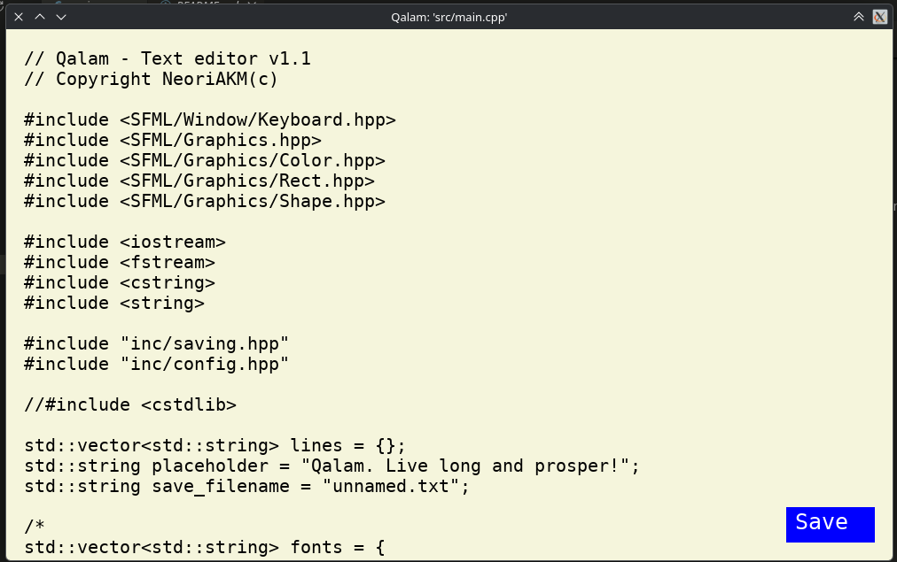
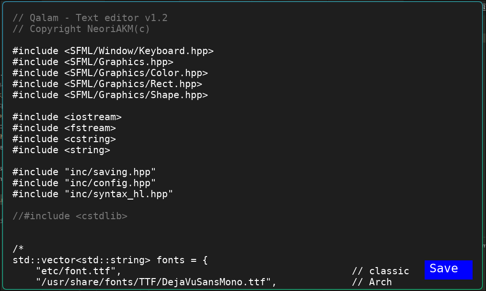

# Qalam - Text editor (v1.2.2)

My first C++ project. A lightweight text editor written in C++ using SFML.

The name comes from the Arabic word قلم (qalam), meaning "pen".

## Features
- Basic work with lines, like any other text editor
- Saving files
- Custom font, font size, and theme via config file
- Dark and light themes
- primitive syntax highlight (only for NASM. But comments in any lang)

## Dependencies
- C++17 compiler (GCC/Clang)
- CMake (3.16+)
- [SFML 3](https://www.sfml-dev.org/) (Graphics, Window, System)
- [nlohmann/json](https://github.com/nlohmann/json)

*On Arch Linux:* `sudo pacman -S cmake sfml nlohmann-json`

## Build

```bash
cmake -B build # once
cmake --build build
```

## Run

```bash
./build/qalam [filename]
```

## Hotkeys

- Ctrl+S and Ctrl+Shift+S : classic
- Ctrl+R : updates config.

## Flags

You can use some flags.
- `--help` or `-h`: for reference
- `--debug` or `-d`: for debug msgs in shell

## Configuration

config file is located at `~/.config/qalam/config.json`. Sorry, windows users, I don't know how to make configs for windows.

Standart config:

```json
{
    "font": "/usr/share/fonts/TTF/DejaVuSansMono.ttf",
    "font_size": 20,
    "theme": "dark",

    "w_width": 1000,
    "w_height": 600,

    "placeholder": "Qalam. Live long and prosper!",
    "unnamed": "unnamed.txt"
}
```

- `font_size` - any int-typed value.
- `font` - absolute path to your font. `/usr/share/fonts/TTF/DejaVuSansMono.ttf` - path only for Arch linux
- `theme` - `"dark"` or `"light"`

- `w_width` and `w_height` - resolution of window. I don't know how to do it dynamic

- `unnamed` - string-value. If you opening Qalam without specifying a file, you will open this file.

## Last update

### 1.2.2

- added "unnamed" & "placeholder" parameters to config.

- fixed few bugs in `dialogues.cpp`

### 1.2.1

- For contributors: You can make button with 1 variable. I made class Button

### 1.2

Syntax highlight

## Gallery






---
---

Copyright NeoriAKM(c) | made with **love** and **C++**